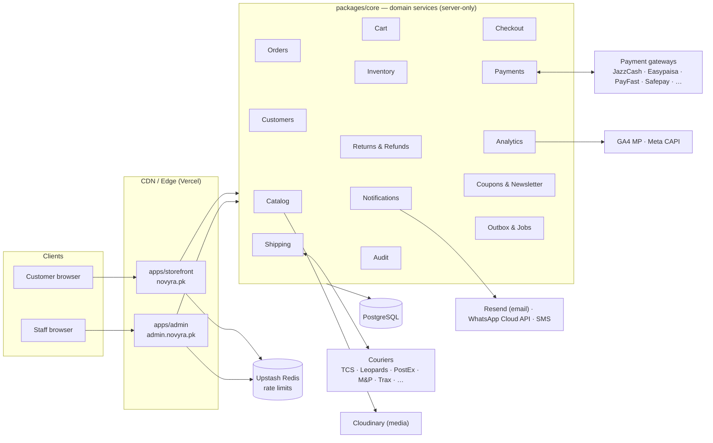
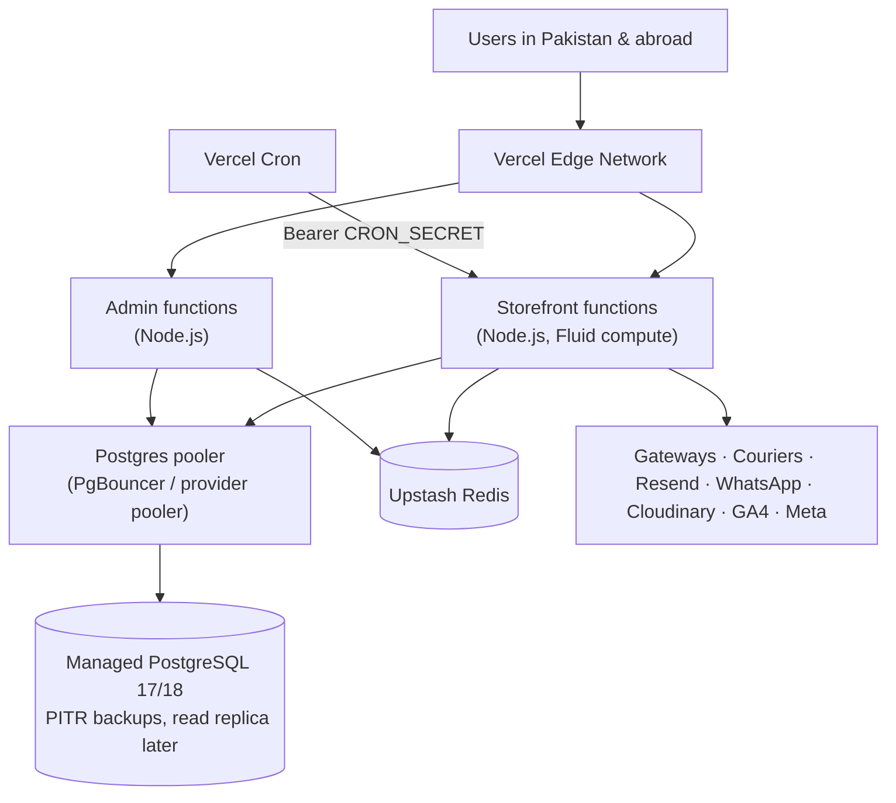
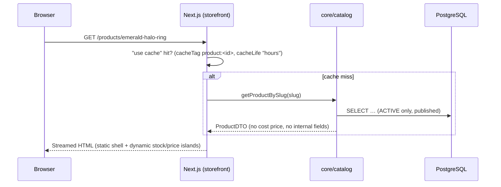
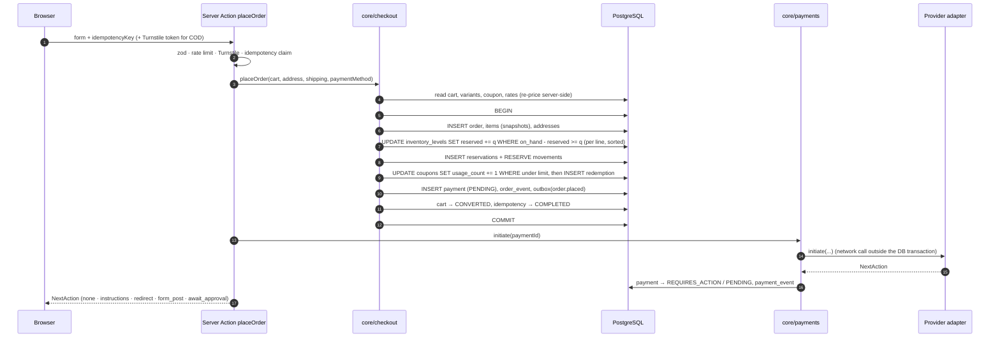
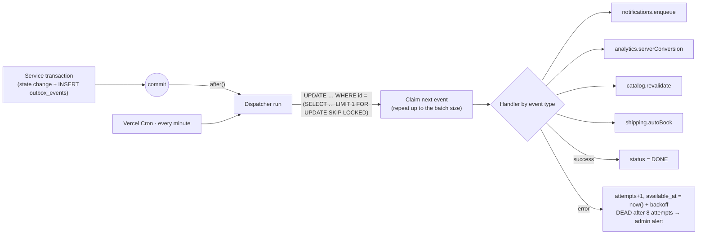

# 01 · System architecture

## 1. Architectural style: modular monolith, two deployable apps

NOVYRA is built as a **modular monolith in a pnpm monorepo** with **two Next.js applications** that share one
domain layer and one PostgreSQL database.



### Why not microservices

Placing an order has to change orders, order items, inventory, coupon usage, payments and the outbox **atomically**.
In one PostgreSQL database that's one transaction. Split across microservices it becomes sagas, compensations
and eventual consistency, which costs a lot of complexity and buys a single-brand store nothing at this scale.

Each domain module still behaves like a service:

- It owns its tables. Only the `orders` module writes `orders`, only `inventory` writes `inventory_levels`.
- It exposes a typed public API (`packages/core/src/<module>/index.ts`). Other modules and apps import **only** that file. ESLint `no-restricted-imports` blocks deep imports.
- It emits domain events through the **transactional outbox**, not direct calls, for anything that isn't required to be atomic (emails, analytics, courier booking, cache invalidation).

This keeps each module extractable. If inventory or notifications ever need to scale on their own, the
public API becomes an HTTP/queue boundary and the outbox becomes a message bus. Callers don't change.

### Why two apps (storefront + admin)

| Benefit | Detail |
|---|---|
| **Session isolation** | The admin session cookie is host-only on `admin.novyra.pk` (`__Host-` prefix) with its own signing secret. An XSS bug on the storefront can never ride a staff session to issue refunds. |
| **Stricter policies** | Admin gets a nonce-based strict CSP, mandatory TOTP 2FA, shorter sessions and lower rate limits. It can also sit behind Cloudflare Access or an IP allowlist without touching the storefront. |
| **Performance** | Admin code (tables, charts, editors) never ships in storefront bundles. |
| **Independent deploys** | A dashboard change can't break checkout, and the reverse. |

Both apps are thin. They hold routes, UI and HTTP adapters, and **all business rules live in `packages/core`**.

## 2. Logical components

The eleven areas from the brief, and where each one lives:

| Area | Lives in | Responsibility |
|---|---|---|
| **Storefront** | `apps/storefront` | Pages, Server Components, Server Actions for cart, checkout, account, reviews, wishlist and newsletter. Cached catalog rendering. |
| **Backend / API** | `packages/core` + route handlers in `apps/storefront/src/app/api/*` | Domain services. HTTP endpoints only where something external must call in: auth, payment/shipping/email webhooks, payment return URLs, cron, health, internal dispatch. |
| **Database** | `packages/db` | Prisma schema, migrations, integrity constraints, client factory, seed. See [02-database.md](02-database.md). |
| **Authentication** | `packages/auth` | Two Better Auth instances (customer, staff), Argon2id, permission catalogue, `requireUser()` / `requirePermission()` guards. See [03-security.md](03-security.md). |
| **Admin dashboard** | `apps/admin` | Operations UI. Every Server Action calls `requirePermission()` and writes an audit log. |
| **Payment service** | `core/payments` | Provider registry, payment state machine, initiation, webhook and return handling, reconciliation, refunds. See [04-payments.md](04-payments.md). |
| **Order service** | `core/orders` + `core/checkout` | Server-side pricing, order placement transaction, order state machine, timeline, cancellation. |
| **Inventory service** | `core/inventory` | Stock levels per location, reservations, commit on shipment, release on cancel/expiry, ledger, low-stock alerts. |
| **Notification service** | `core/notifications` | Template registry, channel senders (email, WhatsApp, SMS, in-app), dedupe, retries, delivery webhooks, suppression. |
| **Shipping service** | `core/shipping` | Zones and rates, courier registry, booking, labels, tracking (webhook or poll), COD collection, RTO, reverse pickups. See [05-shipping.md](05-shipping.md). |
| **Analytics** | `packages/analytics` (browser) + `core/analytics` (server) | Typed commerce events, consent gating, GA4 + Meta Pixel in the browser, GA4 Measurement Protocol + Meta CAPI on the server for purchases. Business reporting runs SQL on our own DB. |

Supporting modules: `catalog`, `cart`, `customers`, `reviews`, `wishlist`, `returns`, `coupons`, `newsletter`,
`media`, `settings`, `audit`, `jobs`.

### Layering rules (enforced by lint)

```
apps/*  ──►  packages/core  ──►  packages/db
   │              │
   ├──► packages/auth ──► packages/db
   ├──► packages/ui          (no server imports)
   ├──► packages/validation  (isomorphic zod schemas, no server imports)
   ├──► packages/analytics   (browser side)
   └──► packages/emails ◄── core/notifications
```

- Every entry point an app imports that can reach the database or secrets (`@novyra/core/platform`, `@novyra/core/shared`, `@novyra/core/settings`, `@novyra/env/server`, and each service module as it is added) starts with `import "server-only"`. A Client Component that imports one fails the build (verified in Phase 0). Internal modules used only by other server code, scripts and tests don't carry the marker; tests alias it to an empty stub.
- Apps never import `@novyra/db` directly. Data access goes through core services, which return **DTOs, never Prisma models**. That prevents leaking columns such as `costPrice`, `password` or `payoutDetailsEncrypted`.
- `core` modules call each other only through their `index.ts` public API.

## 3. Deployment topology



- **Region:** co-locate the functions and the database. Mumbai (`ap-south-1`) and the Gulf regions are the lowest-latency major-cloud regions for Pakistan. Pick one your Postgres provider supports, and put the functions in the same region.
- **Connections:** the app connects through the provider's pooler (`DATABASE_URL`). Migrations use a direct connection (`DIRECT_DATABASE_URL`). Because the pooler runs in transaction mode, the code uses only transaction-scoped features (`pg_advisory_xact_lock`, `SELECT … FOR UPDATE`), never session-level advisory locks or `SET` without `LOCAL`.
- **Environments:** `development` (Docker Compose: Postgres + Mailpit), `staging` (separate DB, provider **sandbox** credentials, `noindex`), `production`. Each environment has its own secrets. Production secrets are never on developer machines.
- **Builds:** each Vercel project runs `turbo run build --filter=@novyra/<app>`. That generates the Prisma client first (so `DIRECT_DATABASE_URL` must be set at build time) and then runs the app's `build` script, whose `check-env` step fails the deployment when the environment is invalid. A build command that calls `next build` directly would skip both.
- **Database timeouts:** opening a pooled connection times out after 5 s and a query with no answer after 30 s (`createPrismaClient`), so a database that goes silent during a failover fails requests instead of hanging them.
- **Self-hosting option:** both apps also build as `output: "standalone"` Docker images. The cron routes then get hit by a small scheduler container or a system cron. Multi-instance self-hosting needs a shared Next.js cache handler (Redis) for tag revalidation.

## 4. Request handling

### 4.1 Read path (catalog)



- Product, category and collection pages are cached and tagged (`product:<id>`, `category:<id>`, `collection:<id>`, `catalog`).
- Live stock and the "only 1 left" signal render in a dynamic island so the cached shell stays fast.
- **Invalidation:** an admin edit commits and writes an outbox event (`catalog.product_updated`). Admin then calls the storefront's signed `POST /api/internal/dispatch`, and the storefront's dispatcher runs `revalidateTag()`. The cron dispatcher retries if the call fails. Worst case staleness is one cron interval.

### 4.2 Write path (commands)

Every mutation follows the same pipeline, whether it arrives as a Server Action or a route handler:

```
input ─► zod parse (packages/validation) ─► authenticate ─► authorize (permission / ownership)
      ─► rate limit ─► idempotency (if non-repeatable) ─► core service (transaction)
      ─► audit log (staff actions) ─► outbox events ─► commit ─► after(): kick dispatcher
```

A single helper in each app, `defineAction({ schema, permission?, rateLimit?, idempotent? }, handler)`, builds this
pipeline so individual actions can't forget a step. Errors map to typed results (`{ ok: false, code, fieldErrors }`).
Stack traces never reach the client.

### 4.3 Checkout and order placement



Rules:

1. **Prices, discounts, shipping and fees are always computed on the server.** The client sends IDs and quantities only.
2. **No network calls inside a database transaction.** Provider calls happen after commit. Their results are applied in a second short transaction.
3. If any line can't be reserved, the whole transaction rolls back and the customer sees which item sold out.
4. Inventory rows are locked in a deterministic order (sorted by variant ID) to avoid deadlocks. Serialization failures and deadlocks (`40001`, `40P01`) are retried up to 3 times with jitter.

## 5. Background processing

There's no separate queue vendor. Work runs from a **transactional outbox** in PostgreSQL:



- **Delivery is at least once**, so every handler is idempotent. Notifications dedupe on `notifications.dedupe_key`, shipments on `booking_idempotency_key`, analytics on `event_id`.
- Concurrent dispatchers can't claim the same event (`FOR UPDATE SKIP LOCKED`). Each event is claimed just before its handler runs, so a long run never holds events it hasn't started, and only the claim that still holds a row (worker id + attempt number) may finish it. Covered by `packages/core/src/shared/outbox.integration.test.ts`.
- Stuck `PROCESSING` rows (lock older than 5 min: the worker crashed, was killed or hung) count as a failed attempt: they go back to `PENDING`, or to `DEAD` once they have used all 8 attempts, so a handler that never returns can't cycle forever. Handlers must finish well inside that window (outbound calls time out after 10 s), and a run can be given a time budget so it ends before its platform limit.

**Scheduled jobs** (`/api/cron/<job>`, authenticated with `Authorization: Bearer ${CRON_SECRET}`):

| Job | Schedule | Purpose |
|---|---|---|
| `outbox-dispatch` | every minute | Safety net for the `after()` trigger. |
| `reservations-expire` | every 5 min | Release stock for online payments not completed within the TTL (default 30 min) and cancel those orders. |
| `payments-reconcile` | every 10 min | Run a status inquiry for `REQUIRES_ACTION` payments older than 10 min, in case a webhook never arrived. |
| `shipments-sync` | every 30 min | Poll tracking for couriers without webhooks (`next_sync_at`). |
| `review-requests` | daily | Ask for a review N days after delivery. |
| `abandoned-carts` | hourly | Only for carts with marketing consent. |
| `cleanup` | daily | Expired sessions, verifications, idempotency keys, abandoned guest carts, `DONE` outbox events older than 30 days. |

> Vercel Cron runs every minute only on paid plans. On Hobby, use an external scheduler or the self-hosted worker
> (`pnpm --filter @novyra/core jobs:run`, which runs the same job functions on an interval).

## 6. Caching strategy

| Data | Strategy |
|---|---|
| Catalog pages, collections, navigation | `"use cache"` + tags + `cacheLife("hours")`. Revalidated by outbox events. |
| Stock badges, price on PDP | Dynamic island, uncached query (cheap, indexed). |
| Cart, checkout, account, admin | Always dynamic, `private` / `no-store`. |
| Images | Cloudinary CDN (`f_auto,q_auto`, responsive widths) through `next/image` with a custom loader. |
| Rate-limit counters | Upstash Redis. |
| Session lookups | Better Auth cookie cache (short-lived signed cookie, 5 min) + DB. |

## 7. Observability and operations

- **Request IDs:** `proxy.ts` keeps an incoming `x-request-id` only when it is a well-formed UUID and otherwise assigns a fresh one, so clients can't put arbitrary text into logs (a client can still choose its UUID). It flows into logs, audit logs, Sentry and outbound provider calls.
- **Structured logs** (pino, `createLogger`). Every logged object is scrubbed at any depth: values under keys naming passwords, tokens, secrets, API keys, authorization, cookies, emails, phones, IBANs, card numbers, CVVs, OTPs or PINs are replaced (case and separators ignored), and emails and card numbers inside strings and messages are masked (docs/03 §14).
- **Sentry** for errors and performance in both apps. PII scrubbing on, source maps uploaded from CI only.
- **Health:** `GET /api/health` checks DB connectivity and outbox backlog. External uptime monitoring alerts on failure.
- **Business alerts:** outbox `DEAD` events, payments stuck in `REQUIRES_ACTION`, unverified bank transfers older than 24h, shipments with no tracking update for 72h, low stock, refund failures.
- **Backups:** managed PITR (≥ 7 days), plus a weekly logical dump to separate storage. Restore drills each quarter.

## 8. Scalability path

| Pressure | First response | Later |
|---|---|---|
| Catalog traffic spikes (campaigns, Eid) | Cached pages at the edge, so the DB barely notices. | — |
| DB read load (admin reports) | Composite indexes already in place. Add a read replica for reports. | Materialised daily-sales views. |
| Search relevance | `pg_trgm` + GIN on product names. | Swap in Meilisearch/Typesense behind a `SearchIndex` interface fed by catalog outbox events. |
| Job volume | Larger dispatcher batches, more frequent cron. | Move the outbox dispatcher to a long-running worker or a managed queue. Handler code is unchanged. |
| Multi-currency / international | `currency` columns already on carts, orders, payments, refunds. | Add `variant_prices(variant_id, currency, amount)` and a geo/currency selector. |
| Multiple brands or regions | — | Add a `store_id` tenant column. Every query already goes through core services, so the change stays contained. |
