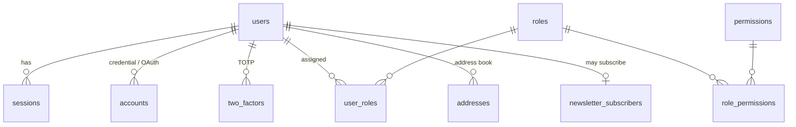
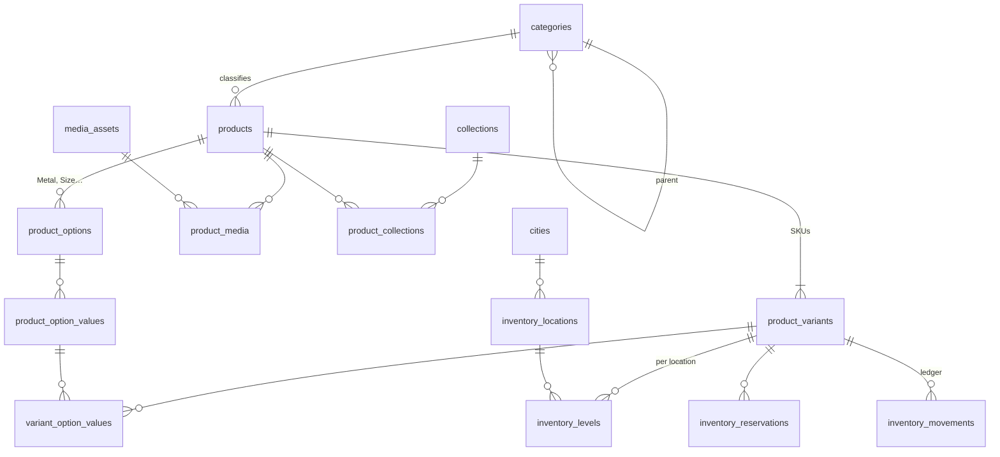
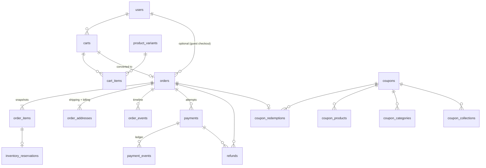
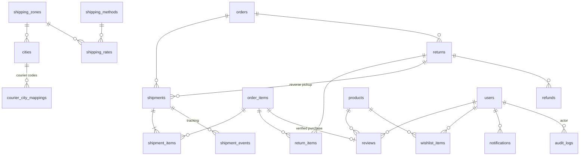

# 02 · Database design

- **Schema:** [`packages/db/prisma/schema.prisma`](../packages/db/prisma/schema.prisma) (58 models, 34 enums)
- **Migrations:** [`packages/db/prisma/migrations/`](../packages/db/prisma/migrations)
  - `20261013000000_init`: generated by Prisma from the schema (+ `pg_trgm`)
  - `20261013000100_integrity_constraints`: hand-written CHECK constraints, partial unique indexes, append-only triggers
  - `20261013000200_idempotency_lock_token`: fencing token for idempotency keys (docs/03 §11)
- **Proof:** [`packages/db/tests/integrity.test.ts`](../packages/db/tests/integrity.test.ts), 14 tests against a real PostgreSQL, including concurrency

## 1. Conventions

| Decision | Choice | Reason |
|---|---|---|
| Primary keys | UUIDv7 (`@default(uuid(7))`, native `uuid`) | Time-ordered (B-tree friendly, no page splits like v4), not enumerable, safe in URLs. |
| Human-facing numbers | `orders.number` / `returns.number` sequences starting at 100001 / 10001, shown as `NV-100001` / `RT-10001` | Readable for customers and couriers without exposing volume or IDs. |
| Naming | snake_case tables (plural) and columns via `@@map` / `@map`; camelCase in TypeScript | Clean SQL for reporting tools; idiomatic TS. |
| Money | `NUMERIC(14,2)` + explicit `currency CHAR(3)` on carts, orders, payments, refunds | Exact arithmetic. Holds up to 999,999,999,999.99, which covers luxury bridal sets (32-bit integer paisa tops out at PKR 21.4M). All arithmetic uses Prisma `Decimal` in a `Money` value object, never JS `number`. |
| Timestamps | `timestamptz(3)`, UTC | No timezone ambiguity. The UI formats in `Asia/Karachi`. |
| Enums | PostgreSQL enums for closed state sets (statuses); `VARCHAR` codes for open sets (payment provider, courier, template) | Adding a payment provider or courier never needs a migration. |
| Snapshots | Orders copy product name, SKU, price, image and address at purchase time | Editing or archiving a product never rewrites order history. |
| Deletion | Orders, payments, refunds, shipments and returns are never deleted by application code: they're cancelled, voided or closed instead. In the database, `ON DELETE RESTRICT` stops an order or payment from being deleted while any payment, refund, shipment, return, event, reservation or coupon redemption references it. Products and variants: archived, not deleted. Users with orders: anonymised (`deleted_at` + PII scrubbed), not deleted. | Accounting, dispute and tax records stay intact. |
| JSON | Only for genuinely schemaless data (redacted provider payloads, spec sheets, personalisation). Each JSON column has a Zod schema in code. | Keeps queryable data relational. |

## 2. Entity-relationship overview

### Identity & access



### Catalog & inventory



### Cart, orders, payments



### Fulfilment, returns, engagement, platform



Platform tables with no FKs (by design): `outbox_events`, `idempotency_keys`, `webhook_events`, `settings`, `payment_methods`.

## 3. Table catalogue

| Domain | Tables | Notes |
|---|---|---|
| **Users & auth** | `users`, `sessions`, `accounts`, `verifications`, `two_factors` | Better Auth core + two-factor plugin shape. Password hashes live in `accounts.password` (Argon2id), never on `users`. `users.email` is lower-case (CHECK). |
| **Roles** | `roles`, `permissions`, `role_permissions`, `user_roles` | Permission keys are defined in code and synced by the seed. Roles are data, so the owner can create custom roles. A role still assigned can't be deleted (`RESTRICT`). |
| **Products** | `products`, `product_options`, `product_option_values`, `product_variants`, `variant_option_values`, `product_media` | Shopify-style option/variant model (Metal × Ring size). Price, SKU and stock live on the variant. `cost_price` is staff-only. Engraving is described by `products.personalization_options` and captured on the cart/order line. |
| **Categories / collections** | `categories` (tree), `collections`, `product_collections` | Categories are structural (Rings › Engagement). Collections are curated and can be time-boxed (`starts_at`/`ends_at`). |
| **Inventory** | `inventory_locations`, `inventory_levels`, `inventory_reservations`, `inventory_movements` | `available = on_hand − reserved`, with `0 ≤ reserved ≤ on_hand` enforced by CHECK. Multi-location ready (boutique, vault, warehouse). The ledger is append-only. |
| **Orders** | `orders`, `order_items`, `order_addresses`, `order_events` | Three orthogonal statuses: `status` (lifecycle), `payment_status`, `fulfillment_status`, plus `cod_verification_status`. `version` column for optimistic concurrency. `attribution` (consent-gated UTM / GA client ID / Meta click IDs) feeds server-side conversions and sales-by-channel reports. Gift flag and message for luxury gifting. |
| **Payments** | `payment_methods`, `payments`, `payment_events`, `refunds`, `webhook_events` | Provider-agnostic: `provider_code` is a string. Several payments per order (failed card then COD; advance + COD balance). CHECKs ensure `refunded ≤ captured ≤ amount`. |
| **Addresses** | `addresses`, `order_addresses`, `cities`, `courier_city_mappings` | Pakistani address shape (area, landmark, E.164 phone). A canonical city list maps to each courier's own city codes. |
| **Coupons** | `coupons`, `coupon_products`, `coupon_categories`, `coupon_collections`, `coupon_redemptions` | Usage limits enforced atomically (see §5). Per-customer limits apply by user **or** email, so guests can't reuse a code. |
| **Reviews** | `reviews` | One per (product, user). Moderated (`PENDING` → `APPROVED`). Verified purchase is linked to an `order_item`. Plain text only. |
| **Wishlist** | `wishlist_items` | One per (user, product), optional preferred variant. Guest wishlists live in local storage and merge on sign-in. |
| **Returns / refunds** | `returns`, `return_items`, `refunds` | RMA with inspection (condition, restock). Refunds go through the gateway API or manually (bank transfer for COD). Payout details are encrypted at the application layer. |
| **Shipping** | `shipping_zones`, `shipping_methods`, `shipping_rates`, `shipments`, `shipment_items`, `shipment_events` | Partial shipments supported. Reverse pickups are `direction = RETURN`. Tracking events dedupe on a hash key. |
| **Notifications** | `notifications` | Outbound message log + idempotency (`dedupe_key`) + delivery status. |
| **Newsletter** | `newsletter_subscribers` | Double opt-in with hashed token and stored consent evidence (text, IP, time). |
| **Audit** | `audit_logs` | Append-only. Who did what, to which entity, before/after (redacted), IP, request ID. |
| **Platform** | `outbox_events`, `idempotency_keys`, `webhook_events`, `settings`, `media_assets` | Reliability infrastructure. See §5 and [01-architecture.md §5](01-architecture.md#5-background-processing). |

## 4. Constraints and indexes

### Constraints the database enforces (`…_integrity_constraints` migration)

| Invariant | Mechanism |
|---|---|
| Stock never negative, never over-reserved | `inventory_levels_on_hand_chk`, `inventory_levels_reserved_chk` |
| Order totals add up | `orders_total_arithmetic_chk`: `total = subtotal − discount + shipping + fees (+ tax if exclusive)` |
| Line integrity | quantity > 0, discount ≤ gross, `0 ≤ fulfilled ≤ quantity`, `0 ≤ returned ≤ fulfilled` |
| Never refund more than captured | `payments_captured_chk`, `payments_refunded_chk`, `refunds_amount_chk` |
| Coupons can't be over-used | `coupons_usage_chk` (`usage_count ≤ usage_limit`), type-specific `coupons_value_chk` |
| Normalised identifiers | lower-case emails, E.164 phones, upper-case coupon codes, kebab-case slugs, ISO currency codes |
| Ratings 1–5, review length ≤ 5000 | `reviews_rating_chk`, `reviews_body_length_chk` |
| Public media has a URL, private media doesn't | `media_assets_public_url_chk`, `media_assets_private_no_url_chk` |
| One default address per user and type, one active cart per user, one default variant per product, one default inventory location, one default zone per country | Partial unique indexes |
| Ledgers can't be rewritten | `enforce_append_only()` trigger on `audit_logs`, `inventory_movements`, `order_events`, `payment_events` (allows only the `ON DELETE SET NULL` of an actor FK) |
| Idempotency | Unique: `payments.idempotency_key`, `refunds.idempotency_key`, `shipments.booking_idempotency_key`, `notifications.dedupe_key`, `(webhook_events.provider, external_id)`, `(idempotency_keys.scope, key)`, `(payments.provider_code, provider_reference)`, `(shipments.carrier_code, tracking_number)`, `(shipment_events.shipment_id, dedupe_key)` |
| Referential integrity | FKs everywhere. `RESTRICT` on financial history, `CASCADE` only for owned children (variants of a product, items of a cart), `SET NULL` for optional actors |

Prisma's diff ignores CHECK constraints, triggers and partial indexes. This was verified: after both migrations,
`prisma migrate diff` and a shadow-database `migrate dev --create-only` report **no drift**. Future schema
changes won't try to drop them.

### Index strategy

Every FK has an index (Postgres doesn't create one automatically). Composite indexes follow the actual query shapes:

| Query | Index |
|---|---|
| Storefront listing: active products, newest first | `products(status, published_at DESC)`, `products(category_id, status)` |
| Search by name (typo-tolerant) | `products_name_trgm_idx` GIN `gin_trgm_ops` |
| Filter by tag | `products(tags)` GIN |
| Customer "My orders" | `orders(user_id, placed_at DESC)` |
| Admin order queue | `orders(status, placed_at DESC)`, `orders(payment_status)`, `orders(fulfillment_status)` |
| Guest order lookup / support search | `orders(email)`, `orders(phone)`, `orders(number)` unique |
| Reservation expiry job | partial `inventory_reservations(expires_at) WHERE status='ACTIVE' AND expires_at IS NOT NULL` |
| Outbox dispatcher | partial `outbox_events(available_at) WHERE status='PENDING'` |
| Notification sender | partial `notifications(scheduled_at) WHERE status='PENDING'` |
| Payment reconciliation | `payments(status, expires_at)` |
| Tracking poller | `shipments(status, next_sync_at)` |
| Product reviews page | `reviews(product_id, status, created_at DESC)` |
| Entity audit trail | `audit_logs(entity_type, entity_id, created_at DESC)` |

## 5. Transactions and concurrency patterns

The default isolation level is **READ COMMITTED**. Correctness comes from **atomic conditional updates** and row locks
(not read-then-write), backed by CHECK constraints. Both concurrency patterns below are tested.

**Reserve stock** (the inventory service's only way to reserve):

```sql
UPDATE inventory_levels
   SET reserved = reserved + $qty, updated_at = now()
 WHERE id = $levelId
   AND on_hand - reserved >= $qty;      -- 0 rows → out of stock → rollback
```

With 8 concurrent requests for 3 units, exactly 3 succeed (`integrity.test.ts › inventory`).

**Consume a coupon:**

```sql
UPDATE coupons SET usage_count = usage_count + 1
 WHERE id = $couponId AND is_active
   AND (usage_limit IS NULL OR usage_count < usage_limit);
```

That row lock also serialises the per-customer check (`COUNT(*) FROM coupon_redemptions WHERE coupon_id = $1 AND (email = $2 OR user_id = $3) AND status = 'APPLIED'`) inside the same transaction.

**State transitions** (orders, payments, returns, shipments) use optimistic concurrency:

```sql
UPDATE orders SET status = 'CONFIRMED', version = version + 1, confirmed_at = now()
 WHERE id = $id AND version = $expectedVersion AND status = 'PENDING';
```

0 rows means someone else changed the order, so reload and re-evaluate. Webhook handlers instead lock the payment row
(`SELECT … FOR UPDATE`) because they must serialise against the same provider event arriving twice.

**Outbox claim:** `FOR UPDATE SKIP LOCKED` (see 01 §5).

### Transaction catalogue

| Command | Inside one transaction | After commit |
|---|---|---|
| Place order | order + items + addresses, reserve stock (sorted by variant), coupon redemption, payment row, order event, outbox, cart → converted, idempotency record | `payments.initiate()` |
| Apply payment update (webhook / inquiry) | insert `webhook_events` (unique), lock payment, verify amount/currency, transition payment, recompute order payment status, confirm order, payment event, outbox | dispatcher |
| Cancel order | transition with version check, release ACTIVE reservations (+ RELEASE movements), reverse coupon redemption, cancel pending payments, order event, outbox | refund flow if money was captured |
| Book shipment | shipment row (PENDING, idempotency key), shipment items | courier `createShipment()`, then a second transaction: tracking number, commit reservations (`on_hand −= q`, `reserved −= q`, SALE movements), `quantity_fulfilled`, fulfilment status, outbox |
| Delivery (tracking) | shipment events (deduped), status, order fulfilment status, COD payment → CAPTURED | notifications, review request schedule |
| Create refund | lock payment, check `amount ≤ captured − refunded − pending refunds`, insert refund (idempotency key), audit log | gateway `refund()` (API) or staff records manual transfer |
| Approve review | review status, recompute `products.rating_average` / `review_count` | revalidate product tag |
| Inventory adjustment | lock level, update, movement with `*_after` snapshots, audit log | low-stock alert |

Transient failures (`40001` serialization, `40P01` deadlock) are retried up to 3 times by `withTransaction()`.
Transactions have a 10-second timeout and never make network calls.

## 6. Migration workflow

```bash
# local: edit schema.prisma, then
pnpm --filter @novyra/db exec prisma migrate dev --name <change>
# hand-written SQL (CHECKs, partial indexes, triggers) goes in its own migration:
pnpm --filter @novyra/db exec prisma migrate dev --create-only --name <change>_constraints
# CI: verify no drift between migrations and schema (needs SHADOW_DATABASE_URL; exit 2 = drift)
pnpm --filter @novyra/db exec prisma migrate diff --from-migrations prisma/migrations --to-schema prisma/schema.prisma --exit-code
# CI: apply all migrations to an empty database and run the integrity tests
pnpm --filter @novyra/db run test:prepare && pnpm --filter @novyra/db run test:integration   # TEST_DATABASE_URL
# production (release pipeline, before the new app version goes live; db:seed generates the client first):
pnpm --filter @novyra/db run migrate:deploy && pnpm db:seed
```

- Production changes are **expand → migrate → contract**: add nullable column, deploy code that writes both, backfill, then make it required and drop the old one in a later release. Never a breaking rename in one step.
- `CREATE INDEX CONCURRENTLY` for large tables after launch (in its own migration, because it can't run inside a transaction).
- Until the first production deploy, the initial migrations may be regenerated freely.

## 7. Data lifecycle and privacy

| Data | Retention | Mechanism |
|---|---|---|
| Orders, payments, refunds, invoices | ≥ 10 years (confirm with your tax advisor) | Never deleted. Customer PII on orders anonymised on erasure requests where the law allows. |
| Sessions, verifications | Until expiry + 7 days | Daily cleanup job |
| Idempotency keys | 24 h (checkout), 30 days (refunds) | `expires_at` + cleanup |
| Outbox events | `DONE`: 30 days. `DEAD`: until a human resolves them | Daily cleanup job |
| Guest carts | 30 days inactivity | cleanup |
| Webhook events | 180 days | Retention job run by a maintenance role |
| Audit logs | ≥ 2 years | Append-only; archived to cold storage before deletion, by a maintenance role that disables the trigger explicitly |
| Notification payloads | 90 days, then payload nulled | Delivery metadata kept |

Account erasure: the user's sessions, accounts, addresses, wishlist and reviews are deleted. `users` becomes
`deleted_at = now()`, `email = 'deleted+<id>@invalid'`, `name = 'Deleted user'`, phone nulled. Orders keep their snapshots
for accounting. Audit logs keep the action, with the actor FK set to NULL if the row is ever removed.

## 8. Seed data

`pnpm db:seed` ([`packages/core/src/seed`](../packages/core/src/seed)) is idempotent and safe to run on every deploy.
Code-owned data is synced to the code. Everything the owner can edit in admin is only created when missing,
never overwritten. CI seeds twice and the integration tests prove both properties.

| Data | Seeded | On re-run |
|---|---|---|
| Permissions | the catalogue in `packages/auth/src/permissions.ts` | synced (added, described, removed) |
| System roles | `owner`, `store_manager`, `finance`, `fulfilment`, `support`, `content_editor` | permission sets reset to the templates (system roles are read-only; custom roles are never touched, docs/03 §4) |
| Cities | 39 Pakistani cities with provinces | missing ones added; existing rows untouched |
| Shipping zone | one default zone, *Pakistan*, holding every seeded city | untouched |
| Shipping methods | `standard`, `insured-express` (offered only once the owner adds rates) | untouched |
| Payment methods | `cod` (enabled), `bank_transfer` (disabled until the owner enters the account details customers see) | untouched |
| Stock location | `MAIN`, the default | untouched |
| Settings | `store`, `tax`, `cod`, `returns`, `inventory` with the decided defaults from [08](08-implementation-plan.md#decisions) | untouched |

Shipping rates, narrower zones, store pickup and gateway payment methods are owner decisions, configured in admin
(Phases 3–5). No demo products or fake orders are ever seeded.
