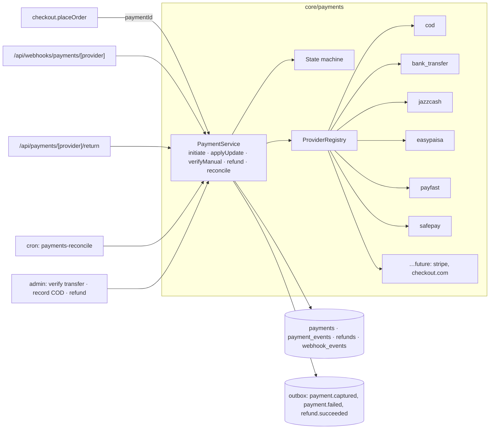
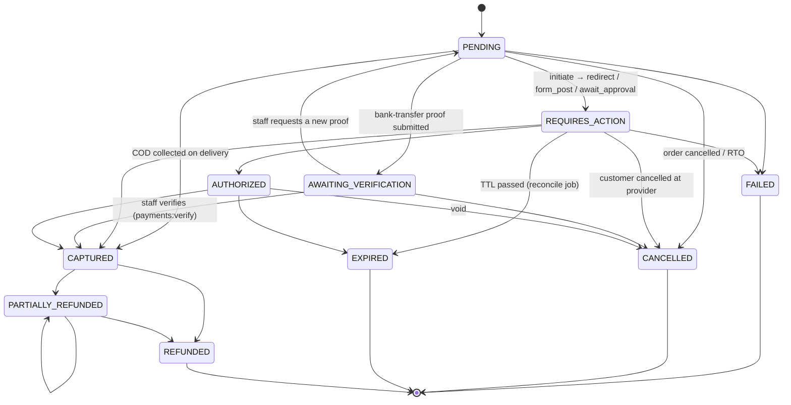
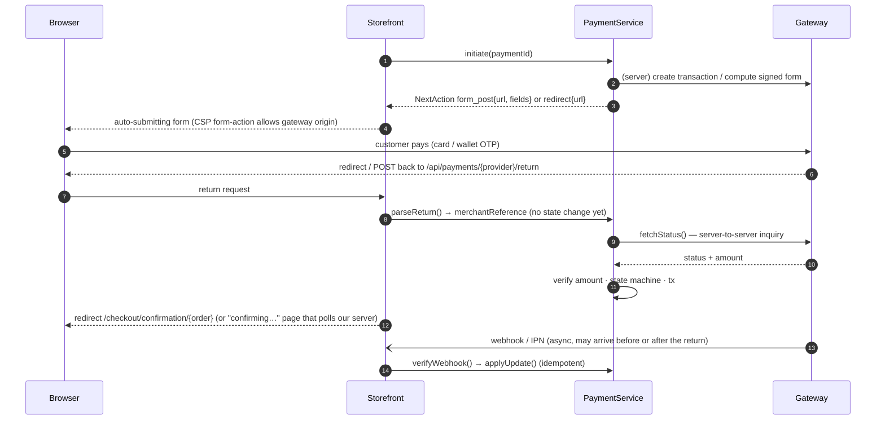

# 04 · Payment architecture

## 1. Goals

1. **No provider is hard-coded.** Checkout, orders, refunds, the admin and reporting know only the `PaymentProvider` interface and a provider **code** string.
2. **Swapping providers needs no changes to the rest of the app.** What it takes:
   - *Enable, disable, reorder, set fees or limits* for a registered provider: admin settings, no deploy.
   - *Rotate credentials or move sandbox → production*: env vars, redeploy, no code change.
   - *Add a new provider*: one new adapter folder + one line in the registry. No changes to checkout, orders, refunds, the DB schema or the UI.
3. **Money state changes only on verified evidence:** a signature-verified webhook or a server-to-server status inquiry. Never on a browser redirect.
4. **Every attempt and every provider message is recorded** (`payments`, `payment_events`, `webhook_events`).

## 2. Components



| Piece | Location | Notes |
|---|---|---|
| `PaymentProvider` contract | `core/payments/types.ts` | Below. Adapters depend only on this, `Money` and `fetch`. |
| Adapters | `core/payments/providers/<code>/` | `index.ts` (adapter), `config.ts` (Zod env schema), `signature.ts`, `mapping.ts` (provider status → normalised), `__fixtures__/` (recorded sandbox payloads). |
| Registry | `core/payments/registry.ts` | `Map<code, PaymentProvider>`. The **only** file that names concrete providers. |
| Non-secret config | `payment_methods` table | Display name, enabled, order, min/max order total, fees, public instructions, provider options. |
| Secrets | env vars only | Validated by the adapter's `config.ts`. `isConfigured()` is false until present. |
| Orchestration | `PaymentService` | The only code that writes `payments`. Applies the state machine, keeps order payment status in sync, writes ledger + outbox. |

## 3. The provider contract

Type-checked under `strict` + `exactOptionalPropertyTypes` (TypeScript 6.0.3).

```ts
// packages/core/src/payments/types.ts
import type { InboundHttpRequest, Money } from "../shared/types.ts";

export type PaymentMethodType = "CASH_ON_DELIVERY" | "BANK_TRANSFER" | "CARD" | "MOBILE_WALLET" | "BNPL" | "OTHER";

/** Provider codes are data, not an enum: adding a provider never needs a DB migration. */
export type PaymentProviderCode = string; // "cod" | "bank_transfer" | "jazzcash" | "easypaisa" | "payfast" | "safepay" | ...

export type PaymentFlow =
  | "offline" //               COD: nothing happens online
  | "manual_verification" //   bank transfer / Raast: customer pays outside, staff verifies proof
  | "redirect" //              hosted payment page (GET redirect or auto-submitted POST form)
  | "embedded" //              provider JS / hosted fields rendered on our checkout
  | "push_approval"; //        mobile wallet: customer approves on their phone

export interface PaymentCapabilities {
  readonly flow: PaymentFlow;
  readonly currencies: readonly string[];
  readonly refunds: "api" | "manual" | "none";
  readonly partialRefunds: boolean;
  readonly webhooks: boolean;
  /** Server-to-server status inquiry is available (used for return URLs and reconciliation). */
  readonly statusInquiry: boolean;
  readonly separateCapture: boolean;
}

export interface InitiatePaymentInput {
  readonly paymentId: string;
  /** Our reference sent to the provider (Payment.providerReference). Unique per provider. */
  readonly merchantReference: string;
  readonly idempotencyKey: string;
  readonly amount: Money;
  readonly order: { readonly id: string; readonly number: string; readonly description: string };
  readonly customer: { readonly name: string; readonly email: string; readonly phone: string };
  readonly returnUrl: string;
  readonly cancelUrl: string;
  readonly webhookUrl: string;
  readonly expiresAt: Date;
  readonly locale: "en" | "ur";
}

/** What the checkout UI must do next. The UI renders this; it never talks to providers directly. */
export type NextAction =
  | { readonly type: "none" }
  | { readonly type: "show_instructions"; readonly instructions: string }
  | { readonly type: "redirect"; readonly url: string }
  | { readonly type: "form_post"; readonly url: string; readonly fields: Readonly<Record<string, string>> }
  | { readonly type: "embedded"; readonly clientToken: string }
  | { readonly type: "await_approval"; readonly message: string; readonly pollAfterMs: number };

export type NormalizedPaymentStatus =
  | "pending" | "requires_action" | "authorized" | "captured" | "failed" | "cancelled" | "expired";

export interface InitiatePaymentResult {
  readonly status: NormalizedPaymentStatus;
  readonly providerTransactionId?: string;
  readonly nextAction: NextAction;
  /** Redacted provider response, stored in PaymentEvent.payload. */
  readonly raw?: Readonly<Record<string, unknown>>;
}

/** A provider's claim about a payment. PaymentService verifies amount + currency before applying it. */
export interface PaymentStatusUpdate {
  readonly merchantReference: string;
  readonly providerTransactionId?: string;
  readonly status: NormalizedPaymentStatus;
  readonly amount: Money;
  readonly failure?: { readonly code: string; readonly message: string };
  readonly occurredAt: Date;
  readonly raw: Readonly<Record<string, unknown>>;
}

export interface VerifiedPaymentWebhook {
  /** Provider event id, or SHA-256 of the raw body when the provider sends none. */
  readonly eventId: string;
  readonly eventType: string;
  readonly updates: readonly PaymentStatusUpdate[];
}

export interface RefundInput {
  readonly refundId: string;
  readonly idempotencyKey: string;
  readonly merchantReference: string;
  readonly providerTransactionId: string;
  readonly amount: Money;
  readonly reason?: string;
}

export interface RefundResult {
  readonly status: "succeeded" | "pending" | "failed";
  readonly providerRefundId?: string;
  readonly failure?: { readonly code: string; readonly message: string };
  readonly raw?: Readonly<Record<string, unknown>>;
}

export interface PaymentProvider {
  readonly code: PaymentProviderCode;
  readonly methodType: PaymentMethodType;
  readonly capabilities: PaymentCapabilities;

  /** True when every required env var is present. Admin cannot enable an unconfigured provider. */
  isConfigured(): boolean;

  initiate(input: InitiatePaymentInput): Promise<InitiatePaymentResult>;

  /**
   * Extract our reference from the customer's browser return. The return is NEVER trusted
   * as proof of payment: PaymentService follows it with fetchStatus() or waits for the webhook.
   */
  parseReturn?(request: InboundHttpRequest): Promise<{ readonly merchantReference: string }>;

  /** Verify signature/HMAC over the raw body. Throws WebhookVerificationError on any mismatch. */
  verifyWebhook?(request: InboundHttpRequest): Promise<VerifiedPaymentWebhook>;

  fetchStatus?(ref: { readonly merchantReference: string; readonly providerTransactionId?: string }): Promise<PaymentStatusUpdate>;

  refund?(input: RefundInput): Promise<RefundResult>;
}
```

Shared types (`core/shared/types.ts`): `Money` is `{ amount: string /* "125000.00" */; currency }`, never a JS
float. `InboundHttpRequest` is `{ method, url, headers, rawBody }`. Adapters convert `Money` to whatever the gateway
expects (e.g. integer paisa strings).

## 4. Payment state machine



- The table of allowed transitions lives in `core/payments/state-machine.ts` and has unit tests. Any other transition is rejected and logged. A late `pending` arriving after `captured` is ignored, never applied.
- **Amount guard:** an update is applied only if `update.amount == payment.amount` and currencies match. A mismatch puts the order `ON_HOLD` and alerts finance.
- After every transition `PaymentService` recomputes `orders.payment_status`:

| Payments for the order | `orders.payment_status` |
|---|---|
| none | `UNPAID` |
| none captured, some pending / requires action / awaiting verification | `PENDING` |
| 0 < captured < order total | `PARTIALLY_PAID` (e.g. advance paid, COD balance due) |
| captured ≥ order total | `PAID` |
| 0 < refunded < captured | `PARTIALLY_REFUNDED` |
| refunded = captured > 0 | `REFUNDED` |
| all cancelled / expired, order cancelled | `VOIDED` |

**When an order becomes `CONFIRMED`** (ready to fulfil):

| Method type | Condition |
|---|---|
| Card / wallet / BNPL | payment `CAPTURED` (or `AUTHORIZED` for separate-capture providers) |
| Bank transfer | staff verified → `CAPTURED` |
| COD | `cod_verification_status` is `VERIFIED` or `NOT_REQUIRED`. The COD payment stays `PENDING` until delivery. |
| COD + advance | advance `CAPTURED` **and** COD verified |

## 5. Flows by method type

### 5.1 Cash on Delivery (`cod`, flow `offline`), no external credentials

1. Checkout checks eligibility: city has `is_cod_available`, phone limit not exceeded, and the order total is within `settings.cod.max_order_total` (starting value PKR 50,000). Above it, an advance payment is required, with the amount set by the owner (decision D4).
2. `initiate()` returns `{ status: "pending", nextAction: { type: "none" } }`.
3. `settings.cod.verification_required` is on (decision D4), so every COD order gets `cod_verification_status = PENDING`. A WhatsApp/SMS/email confirmation goes out, or staff call the customer. Staff (or the customer's confirmation link) set `VERIFIED` → order `CONFIRMED`.
4. The shipment is booked with `cod_amount = order total − captured advance`.
5. Tracking `DELIVERED` → COD payment `CAPTURED` (amount = `cod_amount`). Finance later reconciles against the courier's remittance report (Phase 6+: `cod_remittances` import).
6. RTO / delivery refused → payment `CANCELLED`, order fulfilment `RETURNED_TO_SENDER`, stock back after inspection.

### 5.2 Bank transfer / Raast (`bank_transfer`, flow `manual_verification`), no external credentials

1. `initiate()` returns `show_instructions` with the account title, bank, IBAN / Raast ID from `payment_methods.instructions` (public data, admin-editable), plus the amount and the order number as the payment reference.
2. The customer uploads a receipt (PRIVATE media, signed upload) and enters the transaction reference → `AWAITING_VERIFICATION`.
3. Finance (`payments:verify`) compares against the bank statement and **Verifies** → `CAPTURED`, or **Requests new proof** → `PENDING`. The action is audited with the staff member.
4. Unverified transfers past the SLA (setting, default 48 h) alert staff. Stock stays reserved (no TTL) until verified or cancelled.

### 5.3 Hosted redirect gateways (`redirect`), e.g. JazzCash, Easypaisa, PayFast



The return handler and the webhook both funnel into `PaymentService.applyUpdate()`, which locks the payment row,
so whichever arrives first wins and the other becomes a no-op.

### 5.4 Embedded fields (`embedded`), e.g. Safepay, future international card processors

`initiate()` returns a short-lived `clientToken`. The storefront mounts the provider's script, so card data goes
browser → provider only (PCI SAQ A). Completion is confirmed by webhook or inquiry, as above.

### 5.5 Wallet push approval (`push_approval`)

`initiate()` triggers an approval request on the customer's phone and returns `await_approval`. The page polls **our**
server (`getPaymentStatus`), which calls `fetchStatus()` at most every `pollAfterMs`, until the payment settles or expires.

## 6. Provider catalogue and onboarding

| Code | Provider | Flow | Credentials (env) | Status |
|---|---|---|---|---|
| `cod` | Cash on Delivery | offline | none | **Phase 3**, fully implementable now |
| `bank_transfer` | Bank transfer / Raast | manual_verification | none (instructions in admin) | **Phase 3**, fully implementable now |
| `jazzcash` | JazzCash (wallet + cards) | redirect | `JAZZCASH_MERCHANT_ID`, `JAZZCASH_PASSWORD`, `JAZZCASH_INTEGRITY_SALT`, `JAZZCASH_ENVIRONMENT` | Phase 5, needs merchant account |
| `easypaisa` | Easypaisa | redirect / push_approval | `EASYPAISA_STORE_ID`, `EASYPAISA_HASH_KEY`, `EASYPAISA_ENVIRONMENT` | Phase 5, needs merchant account |
| `payfast` | PayFast (Pakistan) | redirect | `PAYFAST_MERCHANT_ID`, `PAYFAST_SECURED_KEY`, `PAYFAST_ENVIRONMENT` | Phase 5, needs merchant account |
| `safepay` | Safepay | embedded / redirect | `SAFEPAY_API_KEY`, `SAFEPAY_SECRET_KEY`, `SAFEPAY_WEBHOOK_SECRET`, `SAFEPAY_ENVIRONMENT` | Phase 5, needs merchant account |
| *(bank MPGS)* | Bank card acquiring via Mastercard Gateway (HBL, MCB, UBL, …) | redirect | issued by the acquiring bank | Optional |
| *(international)* | Stripe / Checkout.com / similar | embedded | `STRIPE_SECRET_KEY`, `STRIPE_WEBHOOK_SECRET`, `NEXT_PUBLIC_STRIPE_PUBLISHABLE_KEY` | Future. Stripe and PayPal don't onboard Pakistan-registered merchants (check current availability), so this needs an entity in a supported country. |

The env var names are **ours**. The exact credential set and signing algorithm come from each provider's merchant
integration kit at onboarding and are recorded in that adapter's `README.md`. **Until real (sandbox) credentials exist,
an adapter isn't written.** The provider simply isn't registered, so it can't be enabled. No simulated success paths
exist in production code.

### Checklist for adding a provider

1. Get sandbox credentials and the provider's official integration documentation.
2. Create `core/payments/providers/<code>/` with `config.ts` (Zod env), `index.ts` (implements `PaymentProvider`), `mapping.ts`, `signature.ts`, `README.md`.
3. Record real sandbox request/response/webhook payloads into `__fixtures__/` (secrets stripped).
4. Pass the **shared provider contract test suite** (`core/payments/testing/contract.ts`): signature rejects tampered bodies, every provider status maps to a normalised one, amounts round-trip exactly, duplicate webhooks are idempotent, `initiate` is idempotent per key.
5. Add one line to `registry.ts`, add env vars to `packages/env` and `.env.example`, and add the gateway origin to CSP `form-action` / `frame-src`.
6. Staging: run real sandbox transactions end to end (success, failure, cancel, timeout, refund).
7. Production: set live credentials, create the `payment_methods` row (disabled), run a small live transaction, enable.

## 7. Refunds

```
staff: create refund (refunds:create; step-up auth)
  └─ tx: lock payment · available = captured − refunded − pending refunds · amount ≤ available
         · insert refunds(PENDING, idempotency_key) · audit log
  └─ amount > threshold? → wait for a second person with refunds:approve
  └─ provider.capabilities.refunds:
       "api"    → provider.refund() → SUCCEEDED / PENDING (webhook later) / FAILED
       "manual" → staff transfers the money (bank or cash), enters external reference → SUCCEEDED
  └─ on SUCCEEDED (tx): payments.amount_refunded += amount → CAPTURED→PARTIALLY_REFUNDED/REFUNDED
                         · order payment status · order event · outbox(refund.succeeded → customer email)
```

COD orders always refund `manual` (`BANK_TRANSFER` method). The customer's IBAN and account title are collected on the
return request and stored encrypted (`refunds.payout_details_encrypted`, AES-256-GCM), visible only to `payments:verify`.

## 8. Reconciliation

| Check | Frequency | Action |
|---|---|---|
| `REQUIRES_ACTION` older than 10 min | 10 min | `fetchStatus()`. Past TTL → `EXPIRED`, release reservations, cancel order, notify customer with a "retry payment" link. |
| Webhooks with status `FAILED` | 10 min | Re-process (idempotent), with backoff. `DEAD` → alert. |
| Daily settlement report (per gateway, when available) | daily | Import, match by `provider_reference` / `provider_transaction_id`, flag mismatches. |
| COD remittance (courier) | per remittance | Match delivered COD shipments to remitted amounts and flag shortfalls (Phase 6+). |
| `AWAITING_VERIFICATION` older than SLA | hourly | Alert finance. |
