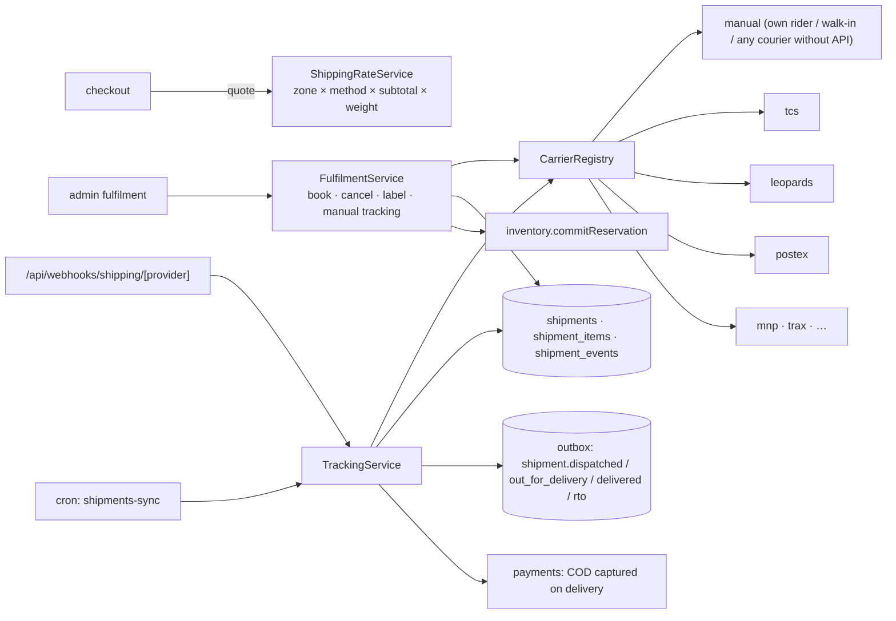

# 05 · Shipping architecture

## 1. Goals

- Couriers are adapters behind one `ShippingProvider` interface, identified by a `carrier_code` string. Adding TCS, Leopards, PostEx, M&P, Trax, BlueEx, Call Courier or Pakistan Post means one new adapter folder, with no changes to orders, fulfilment, returns or UI.
- **What the customer pays for shipping comes from our own zone and rate tables**, not a live courier quote. Pakistani couriers mostly bill on negotiated contract rates, and the brand decides what to charge (e.g. free insured shipping over PKR 50,000).
- Real-world courier behaviour is handled explicitly: courier-specific city codes, no webhooks (polling), non-idempotent booking APIs, COD collection and remittance, RTO (return to origin), reverse pickups.

## 2. Components



## 3. Rates (customer-facing price)

- **Zones:** each `cities` row points to a `shipping_zones` row (e.g. *Lahore*, *Karachi & Islamabad*, *Major cities*, *Rest of Pakistan*). Cities without a zone fall back to the country's default zone.
- **Methods:** `shipping_methods` (e.g. *Standard*, *Insured Express*, *Store pickup*) carry delivery-time estimates, insurance and signature flags, and a preferred carrier.
- **Rates:** `shipping_rates(zone, method, price, min/max subtotal, min/max weight, free_above_subtotal)`. The most specific active match wins: weight band, then subtotal band. `free_above_subtotal` makes the rate 0 when met.
- The quote is computed **on the server** during checkout and again inside `placeOrder`. The order snapshots `shipping_method_code`, `shipping_method_name` and `shipping_total`.
- An optional `getRates()` on an adapter shows *our cost* to staff during fulfilment. It never sets the customer price.

## 4. Contract

```ts
// packages/core/src/shipping/types.ts
import type { InboundHttpRequest, Money } from "../shared/types.ts";

export type CarrierCode = string; // "manual" | "tcs" | "leopards" | "postex" | "mnp" | "trax" | ...

export type NormalizedShipmentStatus =
  | "PENDING" | "BOOKED" | "PICKED_UP" | "IN_TRANSIT" | "OUT_FOR_DELIVERY" | "DELIVERED"
  | "DELIVERY_FAILED" | "RETURNING" | "RETURNED_TO_SENDER" | "CANCELLED" | "EXCEPTION";

export interface ShippingCapabilities {
  readonly cashOnDelivery: boolean;
  readonly liveRates: boolean;
  readonly tracking: "webhook" | "poll" | "none";
  readonly cancellation: boolean;
  readonly reversePickup: boolean;
  readonly labels: "pdf" | "url" | "none";
  readonly insurance: boolean;
  /** Can we look a booking up by our own reference? Decides whether a timed-out booking can be retried safely. */
  readonly lookupByReference: boolean;
}

export interface ShipmentParty {
  readonly name: string;
  readonly phone: string;
  readonly addressLines: readonly string[];
  readonly cityName: string;
  /** Carrier's own city code, resolved from CourierCityMapping. */
  readonly carrierCityCode: string;
  readonly postalCode?: string;
  readonly countryCode: string;
}

export interface CreateShipmentInput {
  readonly shipmentId: string;
  /** Our reference (order number + shipment suffix), sent to the courier. */
  readonly reference: string;
  readonly idempotencyKey: string;
  readonly serviceCode?: string;
  readonly shipper: ShipmentParty;
  readonly consignee: ShipmentParty;
  readonly pieces: number;
  readonly weightGrams: number;
  readonly declaredValue: Money;
  /** Zero for prepaid orders. */
  readonly codAmount: Money;
  readonly contentsDescription: string;
  readonly specialInstructions?: string;
  readonly insured: boolean;
}

export interface CreateShipmentResult {
  readonly trackingNumber: string;
  readonly label?: { readonly kind: "pdf"; readonly data: Uint8Array } | { readonly kind: "url"; readonly url: string };
  readonly raw?: Readonly<Record<string, unknown>>;
}

export interface TrackingEvent {
  readonly status: NormalizedShipmentStatus;
  readonly carrierStatus: string;
  readonly description?: string;
  readonly location?: string;
  readonly occurredAt: Date;
}

export interface TrackingUpdate {
  readonly trackingNumber: string;
  readonly status: NormalizedShipmentStatus;
  readonly events: readonly TrackingEvent[];
}

export interface ShippingProvider {
  readonly code: CarrierCode;
  readonly capabilities: ShippingCapabilities;
  isConfigured(): boolean;

  createShipment(input: CreateShipmentInput): Promise<CreateShipmentResult>;
  findShipmentByReference?(reference: string): Promise<CreateShipmentResult | null>;
  cancelShipment?(trackingNumber: string): Promise<void>;
  track(trackingNumber: string): Promise<TrackingUpdate>;
  verifyWebhook?(request: InboundHttpRequest): Promise<{ readonly eventId: string; readonly updates: readonly TrackingUpdate[] }>;
  /** Pulls the courier's city list to (re)build CourierCityMapping. */
  listCities?(): Promise<readonly { readonly code: string; readonly name: string }[]>;
  requestReversePickup?(input: CreateShipmentInput): Promise<CreateShipmentResult>;
}
```

### The `manual` carrier is real, not a stub

`manual` covers in-house delivery (a luxury brand's own rider in Lahore), store pickup, and any courier without an API.
Staff enter the tracking number and update statuses by hand. It needs no credentials and lets the brand ship from day one.
API couriers come later without changing the workflow.

## 5. City mapping

Pakistani couriers identify destinations by **their own city IDs or names**, and the lists differ between couriers.

- `cities` is NOVYRA's canonical list, shown as a searchable dropdown at checkout. Free-text cities are the biggest cause of failed deliveries.
- `courier_city_mappings(carrier_code, city_id, external_code, is_serviceable)` maps each canonical city to each courier.
- `listCities()` pulls the courier's list. An admin screen auto-matches by normalised name and flags unmatched cities for manual mapping.
- At booking, a missing mapping or an unserviceable city blocks the booking with a clear message, before any API call is made.

## 6. Booking flow (idempotent against non-idempotent APIs)

```
staff selects items + carrier + service  (shipments:manage)
 └─ tx1: shipments(PENDING, booking_idempotency_key) + shipment_items     ← retried clicks reuse this row
 └─ adapter.createShipment()   (outside any transaction, 15 s timeout)
      ├─ success  → tx2: tracking_number, label → PRIVATE media, status BOOKED,
      │                 commit reservations (on_hand −= q, reserved −= q, SALE movements),
      │                 order_items.quantity_fulfilled += q, order fulfilment status,
      │                 order_event (customer-visible) + outbox(shipment.dispatched)
      ├─ definite failure (4xx, validation) → status stays PENDING, last_error shown to staff
      └─ timeout / 5xx (outcome unknown)
             ├─ capabilities.lookupByReference → findShipmentByReference(reference) → adopt result or retry once
             └─ otherwise → status EXCEPTION "verify in courier portal before re-booking"
```

Most Pakistani courier booking APIs take no idempotency key, so a blind retry after a timeout could create two
consignments. That's why outcome-unknown bookings are never auto-retried without a lookup.

## 7. Tracking

- **Webhook couriers:** signature or shared-secret verified, `webhook_events` de-duplicated, then the same `TrackingService.apply()` path.
- **Polling couriers:** `shipments-sync` picks shipments by `next_sync_at` (the `shipments(status, next_sync_at)` index keeps this cheap). Backoff follows status: every 2 h in transit, every 30 min out for delivery, stops when terminal.
- Each carrier status maps through the adapter's `mapping.ts` to a `NormalizedShipmentStatus`. Unknown codes map to `EXCEPTION` and alert staff.
- `shipment_events` is de-duplicated by `dedupe_key = sha256(occurredAt + carrierStatus + location)`, so re-polling is harmless.
- Status effects:

| Normalised status | Effects |
|---|---|
| `BOOKED` | customer: "Your order is on its way" + tracking link |
| `OUT_FOR_DELIVERY` | customer notification (WhatsApp if opted in). For COD: "please keep PKR X ready" |
| `DELIVERED` | order fulfilment → `DELIVERED` (→ `COMPLETED` when all shipments delivered); COD payment → `CAPTURED`; schedule review request |
| `DELIVERY_FAILED` | notify customer + support task. The courier re-attempts. |
| `RETURNED_TO_SENDER` | fulfilment `RETURNED_TO_SENDER`, COD payment `CANCELLED`, return-to-stock inspection task, customer RTO counter + risk flag |

## 8. Returns and reverse logistics

A return approved with pickup creates a `shipments` row with `direction = RETURN` and `return_id`, booked through
`requestReversePickup()` when the courier supports it, otherwise `manual`. A partial unique index allows only one
live pickup per return. On `RECEIVED`, staff inspect each line (`condition`, `restock`). Restocked units go back
through an inventory `RETURN_RESTOCK` movement.

## 9. Courier catalogue

| Code | Courier | Typical integration | Credentials | Status |
|---|---|---|---|---|
| `manual` | Own rider / pickup / any courier | staff-entered | none | **Phase 4**, usable at launch |
| `tcs` | TCS | REST booking + tracking | issued by TCS (API key / client credentials, account number) | Phase 6 |
| `leopards` | Leopards Courier | REST booking + tracking + city list | API key + API password | Phase 6 |
| `postex` | PostEx | REST, COD-focused, fast remittance | API token, pickup address code | Phase 6 |
| `mnp` | M&P (Muller & Phipps) | REST | issued by M&P | Phase 6+ |
| `trax` | Trax | REST | API key | Phase 6+ |

As with payments, the exact credential set comes from each courier's API documentation at onboarding. An adapter is
written only against real sandbox or test-account credentials.

## 10. Luxury-specific handling

- **Insured shipping** (`shipping_methods.is_insured`): declared value = order value, passed as `insured: true` where the courier supports it.
- **Signature on delivery** and **"do not leave with neighbour"** go into `specialInstructions`.
- **Discreet packaging:** the contents description defaults to a neutral "Accessories" text (a setting), so labels don't advertise fine jewellery.
- **High-value threshold:** above a set value, the order requires `insured-express` or store pickup, and staff must confirm the booking.
