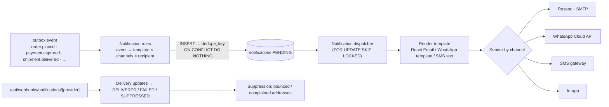
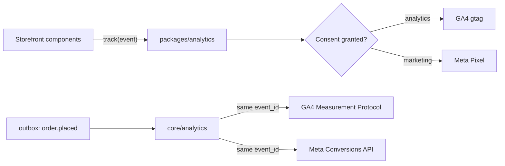

# 06 · Notifications, media, analytics and other integrations

Every external service sits behind an interface in `packages/core` (or `packages/analytics` for browser code), has a
Zod-validated env schema, and reports `isConfigured()`. When an integration isn't configured, it is
**unavailable**, not faked: the feature that depends on it is disabled or fails loudly at boot in production.

## 1. Notification service

### Design



- **Templates** live in `core/notifications/templates/<key>.ts`. Each declares a Zod payload schema, the allowed channels, and renderers (React Email from `packages/emails` for email, an approved template name + variables for WhatsApp, plain text for SMS).
- **Idempotency:** `dedupe_key = <template>:<entityId>:<channel>`, unique in the DB. A redelivered outbox event can't double-send.
- **Retries:** transient errors (timeouts, 429, 5xx) back off at 1 m, 5 m, 30 m, 2 h, 6 h. Permanent errors (invalid recipient, 4xx) → `FAILED`.
- **Suppression:** hard bounces and complaints suppress that address for marketing and flag it for transactional mail. Staff see the flag on the customer record.
- **Transactional vs marketing:** transactional messages (orders, payments, shipping, account security) always go out. Marketing (newsletter, abandoned cart, back-in-stock) requires recorded consent and carries `List-Unsubscribe` + one-click unsubscribe (RFC 8058).
- **Auth emails** (verification, password reset, staff invite) are sent **immediately** in the request, not through the outbox. The token-bearing URL is never stored: the `notifications` row records the template and status with the URL redacted.

### Template catalogue (v1)

| Area | Templates |
|---|---|
| Account | `auth.verify_email`, `auth.password_reset`, `auth.new_sign_in`, `staff.invite` |
| Orders | `order.received`, `order.cod_confirmation_request`, `order.confirmed`, `order.cancelled` |
| Payments | `payment.bank_transfer_instructions`, `payment.received`, `payment.failed_retry`, `refund.succeeded` |
| Shipping | `shipment.dispatched`, `shipment.out_for_delivery`, `shipment.delivered`, `shipment.delivery_failed` |
| Returns | `return.requested`, `return.approved`, `return.received`, `return.rejected` |
| Engagement | `review.request`, `newsletter.confirm`, `newsletter.welcome` |
| Staff alerts | `alert.low_stock`, `alert.outbox_dead`, `alert.transfer_unverified`, `alert.payment_mismatch` |

### Contract

```ts
// packages/core/src/notifications/types.ts
import type { InboundHttpRequest } from "../shared/types.ts";

export type NotificationChannel = "EMAIL" | "SMS" | "WHATSAPP" | "IN_APP";

export interface RenderedMessage {
  readonly notificationId: string;
  readonly channel: NotificationChannel;
  readonly to: string;
  readonly subject?: string;
  readonly html?: string;
  readonly text: string;
  /** WhatsApp/SMS providers that require pre-approved templates. */
  readonly template?: { readonly name: string; readonly language: string; readonly variables: readonly string[] };
  readonly idempotencyKey: string;
}

export interface DeliveryUpdate {
  readonly providerMessageId: string;
  readonly status: "DELIVERED" | "FAILED" | "SUPPRESSED";
  readonly reason?: "bounce" | "complaint" | "invalid_recipient" | "other";
  readonly occurredAt: Date;
}

export interface NotificationSender {
  readonly code: string; // "resend" | "smtp" | "whatsapp_cloud" | ...
  readonly channel: NotificationChannel;
  isConfigured(): boolean;
  send(message: RenderedMessage): Promise<{ readonly providerMessageId: string }>;
  verifyWebhook?(request: InboundHttpRequest): Promise<readonly DeliveryUpdate[]>;
}
```

### Channels

| Channel | Adapter | Credentials | Phase |
|---|---|---|---|
| Email (production) | `resend` | `RESEND_API_KEY`, `RESEND_WEBHOOK_SECRET`, verified sending domain (SPF, DKIM, DMARC on `novyra.pk`) | 1 |
| Email (local dev) | `smtp` → Mailpit in Docker Compose | `SMTP_HOST`, `SMTP_PORT` | 0 |
| WhatsApp | `whatsapp_cloud` (Meta WhatsApp Business Platform, Cloud API) | `WHATSAPP_ACCESS_TOKEN`, `WHATSAPP_PHONE_NUMBER_ID`, `WHATSAPP_BUSINESS_ACCOUNT_ID`, `WHATSAPP_APP_SECRET`, `WHATSAPP_WEBHOOK_VERIFY_TOKEN`. Templates must be pre-approved by Meta. Customer opt-in is required. | 7 |
| SMS | `sms_<provider>`: a Pakistani SMS aggregator chosen at onboarding | provider-specific | 7 (optional) |
| In-app | `in_app` (rows read by *Account › Notifications* and the admin bell) | none | 4 |

The `smtp` adapter is a real SMTP client. Production env validation rejects `EMAIL_PROVIDER=smtp` pointed at Mailpit,
so the dev mail sink can never be live.

## 2. Media storage

### Design

- **Direct-to-cloud uploads:** the admin (or a customer uploading a payment proof) asks the server for an `UploadTicket`. The server signs it with a fixed folder, max size and allowed MIME types. The browser uploads straight to the provider. The server then calls `confirmUpload()`, which **re-reads the object's metadata from the provider** before creating `media_assets`. File bytes never pass through our functions.
- **Public** (product imagery, editorial) is served by CDN URL. **Private** (payment proofs, shipping labels) is served only through signed URLs with ≤ 5 min TTL, after a permission or ownership check.
- **Accepted types:** JPEG, PNG, WebP, AVIF (images ≤ 15 MB, originals ≥ 2500 px for zoom), MP4 (product video ≤ 100 MB), PDF (proofs and labels ≤ 5 MB). **SVG is rejected.**
- Delivery uses `next/image` with a custom loader that builds provider URLs (`f_auto,q_auto,c_limit,w_<w>`). Derivatives strip EXIF/GPS metadata.

### Contract

```ts
// packages/core/src/media/types.ts
export type MediaVisibility = "PUBLIC" | "PRIVATE";

export interface UploadTicket {
  /** The browser uploads straight to the storage provider; our servers never proxy file bytes. */
  readonly uploadUrl: string;
  readonly method: "POST" | "PUT";
  readonly fields: Readonly<Record<string, string>>;
  readonly storageKey: string;
  readonly expiresAt: Date;
  readonly maxBytes: number;
  readonly allowedMimeTypes: readonly string[];
}

export interface StoredObject {
  readonly storageKey: string;
  readonly mimeType: string;
  readonly sizeBytes: number;
  readonly width?: number;
  readonly height?: number;
  readonly checksum?: string;
}

export interface MediaStorage {
  readonly code: string; // "cloudinary" | "s3"
  isConfigured(): boolean;
  createUploadTicket(input: {
    readonly visibility: MediaVisibility;
    readonly folder: "products" | "content" | "payment-proofs" | "shipping-labels";
    readonly allowedMimeTypes: readonly string[];
    readonly maxBytes: number;
  }): Promise<UploadTicket>;
  /** Re-reads the object from the provider and validates type/size before a MediaAsset row is created. */
  confirmUpload(storageKey: string): Promise<StoredObject>;
  putObject(input: { readonly storageKey: string; readonly visibility: MediaVisibility; readonly contentType: string; readonly data: Uint8Array }): Promise<StoredObject>;
  publicUrl(storageKey: string, transform?: { readonly width?: number; readonly quality?: "auto" | number }): string;
  signedUrl(storageKey: string, ttlSeconds: number): Promise<string>;
  delete(storageKey: string): Promise<void>;
}
```

| Adapter | Use | Credentials |
|---|---|---|
| `cloudinary` (default) | Public imagery with on-the-fly transforms; private assets via authenticated delivery + signed URLs | `CLOUDINARY_CLOUD_NAME`, `CLOUDINARY_API_KEY`, `CLOUDINARY_API_SECRET`, `NEXT_PUBLIC_CLOUDINARY_CLOUD_NAME` |
| `s3` (alternative) | Any S3-compatible store (Cloudflare R2, AWS S3) + Next.js image optimisation | `S3_ENDPOINT`, `S3_REGION`, `S3_BUCKET_PUBLIC`, `S3_BUCKET_PRIVATE`, `S3_ACCESS_KEY_ID`, `S3_SECRET_ACCESS_KEY`, `NEXT_PUBLIC_MEDIA_BASE_URL` |

`media_assets.provider` records which adapter owns each object, so a migration between providers can run gradually.

## 3. Analytics

### Two kinds of analytics

| Kind | Source of truth | Used for |
|---|---|---|
| **Business reporting** (revenue, AOV, COD vs prepaid, RTO rate, refund rate, top products, stock value) | **Our PostgreSQL**, through the admin dashboard (SQL aggregates, later materialised views) | Decisions. Exact, includes offline payments and returns. |
| **Marketing analytics** (traffic, funnels, campaigns, ad optimisation) | GA4 and Meta | Acquisition. Sampled, consent-dependent. |

### Event pipeline



- **One typed event vocabulary** (GA4 recommended e-commerce names) maps per destination: `view_item` → Meta `ViewContent`, `add_to_cart` → `AddToCart`, `begin_checkout` → `InitiateCheckout`, `add_payment_info` → `AddPaymentInfo`, `purchase` → `Purchase`, `add_to_wishlist` → `AddToWishlist`, `search` → `Search`, `sign_up` → `CompleteRegistration`, `newsletter_subscribe` → `Lead`.
- **Purchases are measured server-side too** (ad blockers and Safari ITP drop browser events). The browser `purchase` and the server send share `event_id = order.id`, so GA4 and Meta de-duplicate. GA client ID, `_fbp`/`_fbc`, UTMs, landing page and referrer are captured at checkout (consent permitting) into `orders.attribution`.
- **Consent:** Google Consent Mode v2 (`ad_storage`, `analytics_storage`, `ad_user_data`, `ad_personalization`) with a NOVYRA-designed banner. Destinations fire only when their category is granted.
- **Privacy:** no PII is ever sent to GA4. Meta CAPI receives only SHA-256 hashes of normalised email and phone (Meta's required format), and only with marketing consent.
- Purchase value is sent at placement. For a COD-heavy business, a server-only `order_delivered` event is also available, so ad platforms can optimise on delivered revenue rather than placed orders (see open decisions).

### Contracts

```ts
// packages/analytics/src/events.ts — one typed vocabulary for every destination
export interface AnalyticsItem {
  readonly itemId: string; // SKU
  readonly itemName: string;
  readonly itemVariant?: string;
  readonly itemCategory?: string;
  readonly price: number; // display units, analytics only, never used for charging
  readonly quantity: number;
}

export type CommerceEvent =
  | { readonly name: "view_item"; readonly currency: string; readonly value: number; readonly items: readonly AnalyticsItem[] }
  | { readonly name: "view_item_list"; readonly listId: string; readonly items: readonly AnalyticsItem[] }
  | { readonly name: "search"; readonly searchTerm: string }
  | { readonly name: "add_to_wishlist"; readonly currency: string; readonly value: number; readonly items: readonly AnalyticsItem[] }
  | { readonly name: "add_to_cart"; readonly currency: string; readonly value: number; readonly items: readonly AnalyticsItem[] }
  | { readonly name: "remove_from_cart"; readonly currency: string; readonly value: number; readonly items: readonly AnalyticsItem[] }
  | { readonly name: "begin_checkout"; readonly currency: string; readonly value: number; readonly coupon?: string; readonly items: readonly AnalyticsItem[] }
  | { readonly name: "add_shipping_info"; readonly currency: string; readonly value: number; readonly shippingTier: string }
  | { readonly name: "add_payment_info"; readonly currency: string; readonly value: number; readonly paymentType: string }
  | {
      readonly name: "purchase";
      readonly transactionId: string;
      readonly currency: string;
      readonly value: number;
      readonly tax: number;
      readonly shipping: number;
      readonly coupon?: string;
      readonly items: readonly AnalyticsItem[];
    }
  | { readonly name: "sign_up"; readonly method: string }
  | { readonly name: "newsletter_subscribe" };

export type ConsentCategory = "analytics" | "marketing";

export interface AnalyticsDestination {
  readonly id: "ga4" | "meta_pixel" | (string & {});
  readonly requires: ConsentCategory;
  /** `eventId` is shared with the server-side send (GA4 MP / Meta CAPI) for de-duplication. */
  track(event: CommerceEvent, context: { readonly eventId: string }): void;
}

/** Server-side conversion sinks, fed from the outbox (purchase is never client-only). */
export interface ServerConversionSink {
  readonly id: "ga4_measurement_protocol" | "meta_conversions_api" | (string & {});
  isConfigured(): boolean;
  send(event: Extract<CommerceEvent, { name: "purchase" }>, context: {
    readonly eventId: string;
    readonly occurredAt: Date;
    readonly clientId?: string; // GA4 client id captured at checkout
    readonly fbp?: string; // Meta browser id cookie
    readonly fbc?: string; // Meta click id cookie
    readonly hashedEmail?: string; // SHA-256, lower-cased, trimmed
    readonly hashedPhone?: string;
    readonly ipAddress?: string;
    readonly userAgent?: string;
  }): Promise<void>;
}
```

| Destination | Public env | Secret env |
|---|---|---|
| GA4 (browser) | `NEXT_PUBLIC_GA_MEASUREMENT_ID` | — |
| GA4 Measurement Protocol | — | `GA4_API_SECRET` |
| Google Tag Manager (optional, instead of direct gtag) | `NEXT_PUBLIC_GTM_ID` | — |
| Meta Pixel | `NEXT_PUBLIC_META_PIXEL_ID` | — |
| Meta Conversions API | — | `META_CAPI_ACCESS_TOKEN`, `META_CAPI_TEST_EVENT_CODE` (staging only) |

## 4. Platform services

| Service | Interface / module | Credentials | Without credentials |
|---|---|---|---|
| Rate limiting | `core/shared/rate-limit.ts` (Upstash `Ratelimit`) | `UPSTASH_REDIS_REST_URL`, `UPSTASH_REDIS_REST_TOKEN` | dev: in-process limiter. **Production boot fails.** |
| Bot protection | `core/shared/turnstile.ts` | `NEXT_PUBLIC_TURNSTILE_SITE_KEY`, `TURNSTILE_SECRET_KEY` | Production boot fails (COD checkout depends on it). |
| Error tracking | Sentry (`instrumentation.ts`) | `SENTRY_DSN`, `NEXT_PUBLIC_SENTRY_DSN`; `SENTRY_AUTH_TOKEN` in CI only | Logs only (allowed in dev and staging). |
| Google sign-in (optional) | Better Auth social provider | `GOOGLE_CLIENT_ID`, `GOOGLE_CLIENT_SECRET` | Button hidden. |
