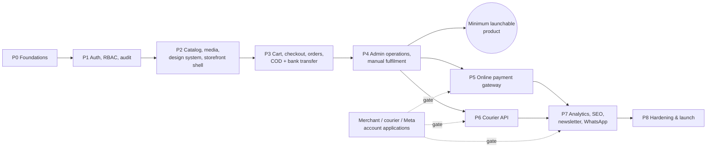

# 08 · Implementation plan

Each phase ends with something deployable to **staging** and a review gate. **UI work starts in Phase 2**,
once this architecture is approved. Phases 0–1 build the foundations every screen depends on.

## Phase overview

Duration depends on team size and on how fast merchant and courier accounts are approved, which is often the
critical path in Pakistan. **Start those applications now.** Phases 5 and 6 can run in parallel.

---

### Phase 0: Foundations

**Done in this change:** architecture docs, Prisma schema, initial migration, integrity-constraints migration,
DB integrity test suite, `.env.example`, pnpm workspace.

Remaining:
- Root tooling: `turbo.json`, shared `tsconfig`/ESLint (with import-boundary rules)/Prettier in `packages/config`, Renovate config.
- `docker-compose.yml`: PostgreSQL 17 + Mailpit.
- `packages/env` (server/client Zod schemas, boot-time validation).
- `packages/db`: `client.ts` (Prisma + `@prisma/adapter-pg`, singleton), `withTransaction()` with retry, **seed** (permissions, roles, cities with provinces, zones, shipping methods, `cod` + `bank_transfer` payment methods, default location, settings).
- `packages/core/shared`: `Money`, error types, `Result`, logger with redaction, request context, idempotency helper, outbox writer + dispatcher skeleton, allowlisted `fetch`.
- CI (GitHub Actions): install → lint → typecheck → unit tests → Postgres service → `migrate deploy` → integrity tests → migration drift check → build.
- Empty `apps/storefront` and `apps/admin` Next.js 16 shells (no UI yet) with security headers and `/api/health`.

**Exit:** CI green on a clean clone. `docker compose up && pnpm db:migrate:deploy && pnpm db:seed` works. Health endpoints return `ok` on staging.

### Phase 1: Authentication, RBAC, audit

- `packages/auth`: storefront and admin Better Auth instances, Argon2id, breached-password check, email verification, password reset, session management, TOTP 2FA (mandatory for staff), staff invitations.
- Permission catalogue + guards (`requireUser`, `requirePermission`, `requireFreshSession`). `defineAction()` pipeline (validate → auth → authorise → rate limit → idempotency → audit).
- Upstash rate limiting, Turnstile, audit log service, Resend sender + auth email templates.
- **Tests:** authorisation matrix (every permission × every role), auth flows, rate-limit behaviour, CSRF origin checks.

**Exit:** a staff member can be invited, enrol 2FA and sign in to admin. A customer can sign up, verify and reset. Every denial is audited.

### Phase 2: Catalog, media, design system, storefront shell *(UI begins)*

- `packages/ui`: NOVYRA design language (typography, colour, spacing, motion tokens in Tailwind v4 `@theme`), accessible primitives, Motion presets (respecting `prefers-reduced-motion`).
- Media: `MediaStorage` Cloudinary adapter, signed uploads, admin media library.
- Admin: categories, collections, products with options/variants, inventory levels, publishing workflow, sanitised rich text.
- Storefront: home, listing, collection, product detail (gallery with zoom, variant picker, stock island, reviews summary), search (trigram), navigation, footer, legal pages, sitemap and structured data.
- Caching with `"use cache"` + tags, plus revalidation through the outbox → internal dispatch.

**Exit:** the catalog is managed entirely from admin and renders on staging with Lighthouse ≥ 90 (performance, a11y, SEO) on mobile.

### Phase 3: Cart, checkout, orders, inventory, COD and bank transfer

- Cart (guest cookie token + user cart, merge on sign-in), wishlist, address book with canonical city picker.
- Server-side pricing engine: subtotal, coupons, shipping zones/rates, payment fees, tax mode.
- `placeOrder` transaction (reservation, coupon redemption, payment row, outbox) with idempotency.
- `PaymentService` + state machine + **`cod`** and **`bank_transfer`** providers (these need no external credentials and are fully real), COD verification flow, bank-transfer proof upload.
- Order emails (received, confirmed, bank-transfer instructions), order tracking page, account order history.
- Reservation-expiry and outbox cron jobs.
- **Tests:** pricing unit tests (rounding, coupon caps, free-shipping thresholds), concurrent checkout of the last unit, idempotent double submit, Playwright COD and bank-transfer journeys.

**Exit:** a real customer can place a COD or bank-transfer order on staging end to end. Overselling can't happen even under load.

### Phase 4: Admin operations and manual fulfilment

- Dashboard KPIs and work queues (COD to verify, transfers to verify, ready to ship, returns, low stock).
- Order management: timeline, notes, hold, cancel (releases stock, reverses coupon), edit shipping address before dispatch.
- Fulfilment with the **`manual`** carrier: partial shipments, tracking entry, status updates, packing slip.
- Returns (RMA, inspection, restock), refunds (manual bank transfer, 4-eyes threshold, encrypted payout details), reviews moderation, coupons, newsletter list, customers (with anonymisation), staff and roles, audit viewer, settings.

**Exit:** the business can run day-to-day operations on staging without touching the database. **This is the minimum launchable product** (COD + bank transfer + manual courier booking).

### Phase 5: Online payment gateway (first Pakistani gateway)

*Requires: sandbox + live merchant credentials for the chosen gateway (see open decision D1).*

- Adapter following the checklist in [04-payments.md §6](04-payments.md#checklist-for-adding-a-provider): signature verification, status inquiry, return handling, webhooks, refunds (if the gateway's API supports them).
- Shared provider contract test suite, recorded sandbox fixtures, reconciliation job, CSP `form-action` update.
- Payment retry ("pay with another method") for failed or expired attempts.

**Exit:** sandbox success/failure/cancel/timeout/refund verified on staging, then one small live transaction in production.

### Phase 6: Courier API integration (first courier)

*Requires: courier account + API credentials (open decision D2).*

- Adapter: booking, label to private storage, cancellation, tracking (webhook or polling), city list sync + mapping UI.
- Idempotent booking with lookup-by-reference, `EXCEPTION` handling, RTO flow, COD capture on delivery, COD remittance import.

**Exit:** staging bookings created in the courier's test environment, with labels and tracking flowing into the order timeline.

### Phase 7: Growth: analytics, SEO, newsletter, WhatsApp

- Consent banner (Consent Mode v2), GA4 + Meta Pixel browser events, GA4 Measurement Protocol + Meta CAPI server events with de-duplication, attribution capture.
- Newsletter double opt-in, review-request emails, abandoned-cart emails (consent only).
- WhatsApp Cloud API sender with approved templates (order confirmation, COD confirmation, dispatch, delivery).
- SEO polish: Product/Offer/Review structured data, OG images, canonical URLs, hreflang if Urdu is added.

**Exit:** GA4 DebugView and Meta Events Manager show de-duplicated purchase events from staging (test event code).

### Phase 8: Hardening and launch

- OWASP ASVS L2 review, dependency review, third-party penetration test (before enabling card payments).
- Load test: catalog at campaign traffic, checkout of a limited drop (100 concurrent buyers, 10 units).
- Backups: PITR verified with a restore drill. Runbooks for payment mismatch, webhook outage, courier outage, data-subject requests.
- Monitoring and alerts (Sentry, uptime, business alerts), status of cron jobs, on-call contact list.
- Accessibility audit (WCAG 2.2 AA), performance budget (LCP < 2.5 s on 4G mid-range Android, CLS < 0.1).
- Production cut-over checklist: DNS, TLS, HSTS preload, email domain authentication (SPF/DKIM/DMARC), live credentials, payment-method enablement, robots allowed.

---

## Testing strategy

| Level | Scope | Tooling | Runs |
|---|---|---|---|
| Unit | Money, pricing, coupon rules, state machines, status mappings, signature helpers | Vitest | every PR |
| Database integrity | CHECKs, partial indexes, triggers, concurrency patterns | `node:test` + real Postgres | every PR ✅ |
| Service integration | core services against a real DB (place order, cancel, refund, apply webhook twice) | Vitest + Postgres service container | every PR |
| Provider contract | each payment/shipping adapter against recorded sandbox fixtures + shared contract suite | Vitest | every PR |
| Authorisation matrix | every admin action × every role → allowed/denied as specified in 03 §4 | Vitest | every PR |
| End-to-end | browse → cart → checkout (COD, transfer, gateway sandbox), account, admin fulfilment | Playwright | PR (smoke) + nightly (full) |
| Non-functional | Lighthouse CI, bundle size budget, load tests | Lighthouse CI, k6 | nightly / pre-release |

**Definition of done** for any feature: typed end to end, Zod-validated input, authorisation check plus test, audit
entry for staff mutations, idempotent if it moves money or stock, tests at the right level, no new lint
warnings, docs updated when a contract changes.

---

## Open decisions

These need your input. The architecture supports every option; the answers decide ordering and configuration.

| # | Decision | Options | Recommendation |
|---|---|---|---|
| D1 | First online payment gateway | JazzCash · Easypaisa · PayFast · Safepay · bank MPGS | Whichever approves NOVYRA's merchant account first with card + wallet support. **Apply to two in parallel now.** |
| D2 | First courier API | TCS · Leopards · PostEx · M&P · Trax | One with an API, reliable COD remittance and insured high-value service in your main cities. Launch on `manual` until then. |
| D3 | Pricing model | Fixed prices · gold-rate-linked (weight × daily rate + making charges) | Fixed prices for v1. If gold-linked pricing is wanted, add a `metal_rates` table and a pricing strategy on variants. Order snapshots already make this additive. |
| D4 | COD policy | max COD order value · advance % above threshold · COD fee · mandatory confirmation | COD up to a threshold, mandatory WhatsApp/phone confirmation, advance payment for high-value pieces. |
| D5 | Languages | English only · English + Urdu (RTL) | **Decide before Phase 2.** Urdu needs `next-intl`, RTL-aware components and translated emails. Retrofitting RTL later is expensive. |
| D6 | Hosting | Vercel + managed Postgres (Neon / Supabase / RDS) · self-hosted Docker | Vercel Pro + a managed Postgres in the nearest supported region to Pakistan. |
| D7 | Media vendor | Cloudinary · Cloudflare R2 + Next image optimisation | Cloudinary for v1 (transform quality matters for jewellery photography). |
| D8 | Returns policy | window (days) · engraved/personalised items excluded · exchange vs refund | 7 days, personalised items non-returnable, exchange preferred. |
| D9 | Tax | prices tax-inclusive? · tax registration / FBR invoicing obligations | Tax-inclusive display (`prices_include_tax = true`). Confirm invoicing obligations with your tax advisor. |
| D10 | Ad optimisation signal | purchase at placement · purchase at delivery | Send both: `purchase` at placement plus a server-side `order_delivered` event for value-based bidding on real revenue. |
| D11 | Domains | `novyra.pk` / `novyra.com`, `admin.` subdomain | Confirm, so cookies, CSP and email authentication can be configured. |
| D12 | Repository | Keep in this repo under `novyra/` · move to a dedicated `novyra` repository | Dedicated repository before Phase 0 completes (cleaner CI, permissions and deploy hooks). |

## Accounts and credentials to request now

Long lead times. None of these are needed to approve the architecture, but they gate Phases 5–7:

- Payment gateway merchant accounts (2 candidates) → sandbox + live credentials
- Courier business account + API access
- Meta Business Manager: WhatsApp Business Platform number + template approvals; Pixel + CAPI token
- Google Analytics 4 property (+ Measurement Protocol API secret)
- Resend account + DNS access for `novyra.pk` (SPF/DKIM/DMARC)
- Cloudinary account, Upstash Redis, Sentry, Cloudflare Turnstile
- Managed PostgreSQL (staging + production) and Vercel team
